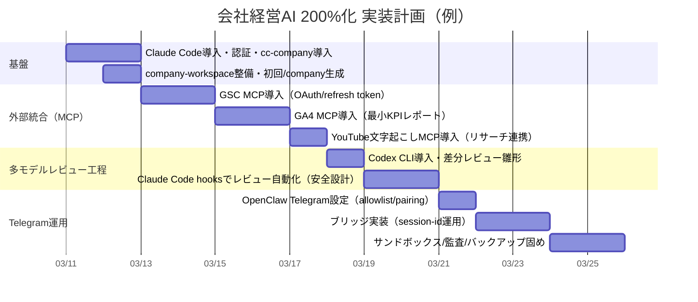

# cc-company を核に「会社経営AI」を200%運用へ拡張するディープリサーチ報告書

## エグゼクティブサマリー

本件の対象は、entity["people","Shin-sibainu","github user"] が entity["company","GitHub","code hosting platform"] で公開している **cc-company** リポジトリ（Claude Codeプラグイン／マーケットプレイス形式）と、ユーザーのローカル作業フォルダ **`/Users/apple/Desktop/アプリ開発（プライベート）/会社経営AI`** です。cc-company は **単一スキル `/company`** によって、対話オンボーディング→`.company/` 構築→「秘書が窓口・CEOが振り分け・部署がファイル管理」という運用を実現します。READMEには、マーケットプレイス追加とプラグインインストールの最短コマンドが明示されています。citeturn4view1turn35view0turn32view0turn32view1

結論として、cc-company単体は「**会社運営の“ファイル器”と基本オペレーション**」として非常に筋が良い一方、200%運用（=より自動化・より計測・より安全・より外部統合・より多モデル）を目指すには次が不足します。

- **外部データ接続（MCP）の標準セット**：Search Console / GA4 / YouTube文字起こし / GitHub / Notion 等を、どのスコープで・どう秘密情報管理するかが未同梱。cc-company側は `.mcp.json` を持たず、設計として“ユーザーが後付け統合する前提”です。citeturn20view0turn34search1turn14search1  
- **役割分割の実装（subagents / hooks）**：現状は“プロンプト上の役割”中心で、実働の分業・検証・レビューが弱い。Claude Codeはプラグインに subagent や hooks を同梱可能で、ここが伸び代です。citeturn20view0turn28view0  
- **スマホ（Telegram）からの操作経路**：ユーザー要望の「フォルダを開かずにスマホから指示」は、entity["organization","OpenClaw","open source ai agent platform"] + entity["company","Telegram","messaging platform"] 経由で “Claude Codeをヘッドレス実行するブリッジ” を作るのが現実的です。Claude Codeは `-p`（非対話）や `--session-id / --resume` を公式に提供しており、Telegramスレッド ↔ Claude Codeセッションを安定マッピング可能です。citeturn25view0turn28view0turn19search11  
- **「開発はClaude Code／レビューはCodex」パイプラインの自動化**：entity["company","OpenAI","ai research company"] の Codex はCLI/SDKでローカルコードレビュー運用が可能で、差分レビュー用のテンプレも提供されています。これを Claude Code hooks と組み合わせると、レビューを“儀式”から“自動工程”にできます。citeturn29search1turn29search6turn20view0  

**未指定（要確認）**：macOSバージョン、Claude Codeの導入方式（install.sh/Homebrew/npm）、OpenClawの稼働場所（同一MacかVPSか）、Telegram運用（DMのみ/グループ併用）、Search Console/GA4/YTの利用アカウントと権限、Codexの利用形態（CLIログインかAPIキーか）、Docker利用可否、秘密情報の保管方針（Keychain/1Password/.env/Secrets Manager）など。

---

## リポジトリ構造と主要ファイルの完全分析

cc-company は「**マーケットプレイス（`.claude-plugin/marketplace.json`）**」と「**プラグイン本体（`plugins/company`）**」を同一リポジトリに持つ最小構成です。マーケットプレイスは `company` プラグインを `./plugins/company` から配布する設計で、カテゴリやタグまで定義されています。citeturn35view0turn4view1  
プラグイン本体は、メタデータ（`plugin.json`）と、スキル定義（`SKILL.md`）および参照テンプレ（`references/*`）で構成され、コード（Node/Python等の実装）は含みません。citeturn6view0turn32view0turn31view0turn32view1

### ファイル一覧（サイズ・目的）

以下は 2026-03-11 時点でリポジトリの raw を取得し、バイト数を計測したものです（画像含む）。

| パス | サイズ | 役割 / 目的 |
|---|---:|---|
| `.claude-plugin/marketplace.json` | 727 B | マーケットプレイス定義。配布するプラグイン一覧・ソース・タグ・ライセンス等を記述。citeturn35view0 |
| `.gitignore` | 9 B | `.claude/` を除外（プロジェクト設定やローカル生成物をコミットしない意図）。citeturn4view0 |
| `README.md` | 3,632 B | 概要、インストールコマンド、使い方例、部署一覧、ファイル構成。citeturn4view1 |
| `LICENSE` | 1,056 B | MIT License。citeturn4view2turn35view0 |
| `image.png` | 92,802 B | コンセプト図（秘書→CEO→各部署、MCP連携）。citeturn5view0turn4view1 |
| `plugins/company/.claude-plugin/plugin.json` | 206 B | プラグインメタデータ（name/description/version）。citeturn6view0 |
| `plugins/company/skills/company/SKILL.md` | 14,300 B | `/company` スキル本体。オンボーディング、`.company/`生成、運営モードの判断、秘書/CEOロジックの手順。citeturn32view0 |
| `plugins/company/skills/company/references/departments.md` | 19,290 B | 各部署の `_template.md` と一部 `CLAUDE.md` 生成の参照テンプレ集（秘書室〜人事など）。citeturn31view0 |
| `plugins/company/skills/company/references/claude-md-template.md` | 4,044 B | `.company/CLAUDE.md` の生成テンプレ（変数置換・運営ルール・命名規則・レビューサイクル）。citeturn32view1 |

### 重要ポイント（設計上の含意）

- **cc-company は「会社オペレーションの記録媒体（Markdown）」を先に定義**し、エージェントの長期記憶を `.company/` 以下のファイルに外部化します（今日のTODO、inbox、決定ログ、週次レビュー等）。citeturn32view0turn31view0turn32view1  
- **MCP統合は前提だが同梱していない**：コンセプト図にMCPが描かれ、テンプレ側でも外部情報源の想定はありますが、`.mcp.json` やMCPサーバ設定は含まれていません（=200%化の最大の伸び代）。citeturn5view0turn20view0turn34search1  
- **「部署」はテンプレとして定義されているが、実行分派は“プロンプト記述”中心**：Claude Codeの subagents / hooks を活用すると、部署ごとの実働（レビュー、SEO分析、会計処理）を強化できます。citeturn20view0turn28view0  

---

## macOS ローカル導入のインストール＆セットアップ手順

ここでは「cc-company をローカルに配置し、Claude Code から `/company` を実行して `.company/` を生成し、以後の運用に入る」までの再現手順を、**macOS前提**で具体化します（未指定：macOSバージョン、CPU、シェル）。  
Claude Code自体は `install.sh` による導入が公式に案内されています。citeturn17search0turn17search8

### 依存関係の前提

- **Claude Code v1.0.33 以上**（`/plugin` が認識される最低条件として明示）。citeturn16search7turn22view0  
- **Git**（リポジトリをクローンしてローカルマーケットプレイスで使う場合）。  
- **Node.js / Python / Docker は必須ではない**（cc-company単体はテンプレ中心）が、後述の **MCP拡張（Search Console/GA4等）** や **OpenClaw sandbox** をやるなら必要になります。特に Claude Code のセットアップでも Node.js 18+ は “非推奨のnpmインストール時のみ必要” とされています。citeturn17search0turn26view0turn8view0turn33search2

### フォルダ準備（ユーザー指定パス）

```bash
mkdir -p "/Users/apple/Desktop/アプリ開発（プライベート）/会社経営AI"
cd "/Users/apple/Desktop/アプリ開発（プライベート）/会社経営AI"
```

（推奨）この直下に、将来の拡張を見据えたサブ構成を用意します：

```bash
mkdir -p company-workspace scripts secrets logs
```

- `company-workspace/`：cc-companyが生成する `.company/` の置き場（作業ディレクトリ）
- `scripts/`：Telegram/OpenClawブリッジ等の実行スクリプト
- `secrets/`：`.env` や鍵類（**git管理しない**）
- `logs/`：実行ログ・監査ログ

### Claude Code のインストール（公式）

```bash
# macOS / Linux / WSL
curl -fsSL https://claude.ai/install.sh | bash

# バージョン確認
claude --version
```

インストールスクリプト（install.sh）と導入方法（安定版・特定バージョン指定）は公式に記載があります。citeturn17search0turn17search8

### 認証（トークン管理の入口）

Claude Code は `claude auth login/status/logout` を提供します。citeturn28view0  
（トークン実体は `~/.claude.json` 等に保存され得るため、保守・バックアップ・消去の運用に乗せるのが重要です。設定や状態の保存場所は公式が説明しています。citeturn17search5turn9search21）

```bash
claude auth login
claude auth status --text
```

### cc-company の導入（2つの方式）

#### 方式A：GitHubマーケットプレイスとして追加（最短・README通り）

Claude Code の対話UIで以下を実行：

```text
/plugin marketplace add Shin-sibainu/cc-company
/plugin install company@cc-company
```

cc-company README で明示されているインストール方法です。citeturn4view1turn23view1  
注意点として、プラグインが見えない場合はキャッシュクリアや再インストールが必要になり得ます（公式のトラブルシューティングに記載）。citeturn23view0turn21view0

#### 方式B：ローカルに clone してローカルマーケットプレイスとして追加（改造・拡張向き）

```bash
cd "/Users/apple/Desktop/アプリ開発（プライベート）/会社経営AI"
git clone https://github.com/Shin-sibainu/cc-company.git
cd cc-company
claude
```

Claude Code 内で：

```text
/plugin marketplace add ./
(plugin list/update も必要なら)
```

ローカルパスからマーケットプレイスを追加できることは公式に説明されています。citeturn23view1  

さらに、**開発中のプラグインを“そのセッションだけ”読み込む**なら `--plugin-dir` が使えます。citeturn28view0turn16search7

```bash
claude --plugin-dir ./plugins/company
```

### `/company` 初回実行（オンボーディング → `.company/` 生成）

cc-company のスキルは、`.company/` の有無で「初回オンボーディング」か「運営モード」かを切り替えます。citeturn32view0  
初回は保存場所選択（カレント/ホーム/カスタム）を案内するため、**ユーザー希望の `company-workspace/` を指定**するのが合理的です。citeturn32view0

推奨実行ディレクトリ：

```bash
cd "/Users/apple/Desktop/アプリ開発（プライベート）/会社経営AI/company-workspace"
claude
```

Claude Code 内：

```text
/company
```

生成物は `.company/CLAUDE.md`（全体ルール）と、秘書室・CEO・レビュー・各部署のテンプレ群です。テンプレの仕様（命名規則、レビューサイクル等）は `claude-md-template.md` と `departments.md` に明記されています。citeturn32view0turn31view0turn32view1

---

## プラグイン登録・インストール検証チェックリスト

プラグイン導入が「確実に再現できる」ことを目的に、**CLI／対話UIの両面**でチェックリスト化します。プラグインの install/enable/disable/update は **非対話CLI**（`claude plugin install ...`）としても提供されています。citeturn21view0turn28view0

### 最小チェック（実行順）

1) **Claude Code が v1.0.33+**  
```bash
claude --version
```
要件が満たされないと `/plugin` が出ません。citeturn22view0turn16search7  

2) **認証済み**  
```bash
claude auth status --text
```
citeturn28view0  

3) **マーケットプレイス追加（対話UI）**  
```text
/plugin marketplace add Shin-sibainu/cc-company
/plugin marketplace list
```
マーケットプレイス操作（add/list/update/remove）は `/plugin marketplace ...` で提供。citeturn23view1turn23view2  

4) **プラグインインストール（対話UI）**  
```text
/plugin install company@cc-company
```
READMEの指定通り。citeturn4view1turn23view1  

5) **プラグイン導入検証**  
- `/company` が候補に出る（スラッシュコマンド）  
- `claude --debug` で読み込み状況が確認できる（プラグイン参照のデバッグ項目）。citeturn21view0  

6) **必要ならキャッシュクリア**  
プラグインスキルが表示されない場合の対応（`~/.claude/plugins/cache` 削除）が公式に記載。citeturn23view0  

### 自動化／スクリプト向け（CLI）

- インストール：  
```bash
claude plugin install company@cc-company --scope user
```

- 更新：  
```bash
claude plugin update company@cc-company --scope user
```

CLI形式・スコープ（user/project/local）・目的はプラグインリファレンスに明示されています。citeturn21view0turn20view0  

---

## スキル・プロンプト・テンプレート分析と改善提案

cc-company の中核は **`company` スキル（`/company`）** です。内容は「検出→オンボーディング→組織生成→運営」の手順書で、生成物の仕様はテンプレファイルにより規定されています。citeturn32view0turn31view0turn32view1

### スキル在庫（現状）

| スキル名 | 意図（Intent） | 入力 | 出力 | 必須MCP | 現状の強み | 改善余地（要点） |
|---|---|---|---|---|---|---|
| `company` (`/company`) | 仮想会社組織の構築と運営（秘書窓口＋CEO振分＋部署別ファイル運用）citeturn32view0 | 初回：対話ヒアリング（事業/目標/困りごと/部署/言語/保存場所）／運営：自然言語相談 | `.company/` ツリー、`CLAUDE.md`、部署テンプレ、TODO/ログ更新 | なし（標準ツールのみ想定） | 「ファイルに落とす」ことで長期運用の器ができる／テンプレが具体的 | ①CEO振分けの基準が暗黙 ②定常オペ（朝会/週次/月次）を“専用スキル化”していない ③外部統合（MCP）と秘密管理が未定義 ④レビュー（Codex）工程が未統合 |

### テンプレート設計の読み解き

- **全社ルール（`.company/CLAUDE.md`）**：オーナープロフィール、組織構成、運営ルール、命名規則、TODO形式、レビューサイクル等を含む“憲法”テンプレ。変数（`{{BUSINESS_TYPE}}` 等）をオンボーディング結果で置換する前提です。citeturn32view1turn32view0  
- **部署テンプレ（`departments.md`）**：秘書室のデイリーTODO／inbox／相談メモ、CEOの意思決定ログ、週次レビュー、PMチケット、マーケKPI表、開発デバッグログ、経理請求書などが具体的なMarkdownとして定義されています。citeturn31view0  

### 改善提案（cc-company を“200%化”するためのプロンプト設計）

cc-company の方針（“秘書が窓口、部署は裏方”）は維持しつつ、**Claude Code が持つ拡張機構（subagents / hooks / MCP）** を使って「実装としての分業」「自動監査」「多モデルレビュー」を足します。プラグインが skills/agents/hooks/MCP を束ねられることは公式に説明されています。citeturn20view0turn17search7

提案の核（最小で効く順）：

- **CEO分派を“ルール＋ログ＋検証”で固定化**  
  - `ceo/CLAUDE.md` に「部署選択の決定表（例：売上/SEO→growth、コード→engineering）」と「必ず `ceo/decisions/` に decision log を残す」制約を強化。テンプレ上すでに decision log の器はあるため、実行規律を上げるだけで効果が出ます。citeturn31view0turn32view1  

- **定常オペを“専用スキル”に分割**（現状は1スキルに集約）  
  - `/company-daily`（朝会）：今日のTODO生成・優先順位・ブロッカー確認  
  - `/company-weekly`：週次レビュー生成（reviews/_template.md に沿う）  
  - `/company-monthly`：月次レビュー＋KPI（マーケ/経理）更新  
  Claude Codeは `SKILL.md` でスキルを増やし、`/skill-name` で直接呼べることが公式に明示されています。citeturn19search2turn20view0  

- **“レビューはCodex”を工程として標準化**（次章で詳細）  
  - Claude Code hooks を使い、変更後にレビューを自動起動（ただしセキュアに）。hooks は実行イベントやブロック（deny）等の制御が公式に示されています。citeturn14search2turn20view0  

---

## MCP・スキル拡張の網羅設計（SEO / Search Console / YouTube / Codexレビュー / 監査）

この章は「cc-companyを中心に、**“外部の事実データ”を確実に取り込み、会社運営の意思決定を強くする**」ための拡張案です。Claude Code は `.mcp.json` による MCP サーバ設定、環境変数展開、サードパーティMCPの注意（プロンプトインジェクション等）を明確に述べています。citeturn34search1turn14search1turn17search5

### MCP拡張の基本方針（事故を減らす型）

- **秘密情報は `.mcp.json` に直書きしない**：環境変数展開（`${VAR}`）を使う。citeturn14search1  
- **MCPは「プロジェクトスコープ」を基本**：`.mcp.json` がプロジェクト直下に置かれ、共有可能だが、実キーは env で差し替える（チーム運用に強い）。設定ファイルのスコープ体系は公式に整理されています。citeturn17search5turn20view0  
- **第三者MCPは“信頼できるものだけ”**：公式は「セキュリティ検証していない」「信頼できないコンテンツ取得は特に注意」と明言。citeturn34search1  

### 重点MCP候補（目的別）

#### Search Console（最優先：SEOの事実データ）

`google-search-console-mcp-server` は、Search Console API（サイト一覧、検索アナリティクス、サイトマップ、URL検査、インデックス申請等）を Claude Code から扱うことを目的とし、`.mcp.json` の例（npx起動＋OAuth情報）を提示しています。citeturn8view0

- **必要な権限/準備**：Google Cloud Project、Search Console API有効化、OAuth Client（Desktop）、Refresh Token 等（リポジトリに詳細）。citeturn8view0  
- **実装ステップ（要約）**  
  1) OAuthクレデンシャル作成  
  2) `npx` でセットアップして refresh token を取得  
  3) `.mcp.json` にサーバ定義（env は `${...}`）  
  4) Claude Code 再起動／MCP認識

（例：雛形。実値は環境変数で供給）

```json
{
  "mcpServers": {
    "google-search-console": {
      "command": "npx",
      "args": ["-y", "-p", "google-search-console-mcp-server", "google-search-console-mcp"],
      "env": {
        "GOOGLE_CLIENT_ID": "${GOOGLE_CLIENT_ID}",
        "GOOGLE_CLIENT_SECRET": "${GOOGLE_CLIENT_SECRET}",
        "GOOGLE_REFRESH_TOKEN": "${GOOGLE_REFRESH_TOKEN}"
      }
    }
  }
}
```

※この「args 3点セット（-y / -p / 実行名）」の注意喚起もリポジトリ上で明示されています。citeturn8view0turn14search1  

#### GA4（KPI・ファネルの事実データ）

Google は GA の MCP サーバを “試せる” 旨を公式開発者ドキュメントで案内しており、GitHubでも実装を公開しています。citeturn33search2turn33search0  
cc-companyを「経営」へ寄せるほど、**収益KPI（CV、LTV、離脱、チャネル別）** が重要になるため、Search Consoleと並ぶ中核統合になります。

- **推奨スキル拡張（例）**  
  - `/company-growth:weekly-kpi`：GA4×GSCで週次スコアカード生成（`.company/marketing/` と `.company/finance/` を更新）  
  - `/company-growth:anomaly`：急落・急騰の検知→原因仮説→対策タスク化（PMチケットへ）  

#### YouTube文字起こし（コンテンツ制作の燃料）

YouTubeの内容を「会社ナレッジ」に取り込み、リサーチ→企画→投稿→改善まで回すには、文字起こしMCPが強いです。  
例として `mcp-youtube-transcript` は **URLから transcript / timestamped transcript / 動画メタデータ** を取得でき、Claude（Desktop）や手動設定例も提示しています。citeturn10view0

- **実装ステップ（要約）**：`uvx`（uv）経由やDockerなど複数手段。長尺動画は分割され `next_cursor` でページングする設計です。citeturn10view0  
- **cc-company 側の活用テンプレ（例）**  
  - `research/topics/` に「動画要点＋引用元タイムスタンプ」を保存  
  - `marketing/content-plan/` に「動画→記事/ポストへの再構成案」を保存  
  - `pm/projects/` に「動画企画の制作工程」を起票

#### MCPの追加に伴うセキュリティ（必須）

MCPは強力ですが、組み合わせによってリスクが増す面が現実に指摘されています（例：Git MCPサーバの脆弱性と、他ツール連鎖による影響可能性）。citeturn33news34turn34search1  
したがって、**(1)導入前にコードレビュー、(2)権限最小化、(3)サンドボックス** の3点セットを“運用ルール”にするのが200%運用の前提です。

### Codexベースのレビュー工程（「開発はClaude Code、レビューはCodex」を固定化）

Codex CLI は「ローカル端末から、選択ディレクトリ内のコードを読み・変更し・コマンド実行できる」コーディングエージェントとして説明されています。citeturn29search1  
また、OpenAI Cookbook には **差分レビュー用のプロンプトテンプレ** が提示されています（レビュー観点：正しさ/性能/安全性/保守性など）。citeturn29search6

**提案する“標準フロー”**（最小で回る形）

1) Claude Codeで実装（branch運用を推奨）  
2) 差分を抽出  
3) Codexでレビュー（自動）  
4) レビュー結果を `.company/reviews/` に保存 + 必要ならPMチケット化  
5) 受け入れ後にマージ／リリース

Codex のAPIキーは環境変数 `OPENAI_API_KEY` で扱えることが公式クイックスタートで示されています。citeturn29search11turn29search20  
キー運用のベストプラクティス（個別キー、共有禁止等）も公式ヘルプにまとまっています。citeturn29search7

**実装例（フックで回すためのスクリプト案）**  
Claude Code hooks はプラグインでも設定でき、`PostToolUse` のようなイベントでコマンドを叩けます。citeturn20view0turn14search2  
以下は「git差分→Codexレビュー→`.company/reviews/` に保存」の最小雛形です（実際のCodex CLI引数は環境により調整）。

```bash
#!/usr/bin/env bash
set -euo pipefail

WORKDIR="${1:-.}"
cd "$WORKDIR"

TS="$(date +%Y%m%d-%H%M%S)"
OUT=".company/reviews/codex-review-${TS}.md"

mkdir -p ".company/reviews"

git diff --staged > /tmp/diff.txt || true
git diff > /tmp/diff2.txt || true

cat > /tmp/review_prompt.txt << 'EOF'
あなたはコードレビュワーです。差分だけを見て、正しさ・性能・セキュリティ・保守性の観点で重大な問題から指摘してください。
各指摘は「ファイル名」と「該当行（可能なら）」を添えて短く具体的に。
EOF

# 例：Codex CLIでレビュー（実際のコマンドは環境に合わせて調整）
cat /tmp/diff2.txt | codex -p "$(cat /tmp/review_prompt.txt)" > "$OUT"

echo "Saved: $OUT"
```

**200%化のポイント**：この出力をそのまま終わらせず、cc-company側で「秘書→PM→開発」へ戻して**改善タスク化**する（=レビューが成果に変換される）ことです。

---

## Telegram + OpenClaw でスマホから会社運営エージェントを操作する設計

ユーザー要望は「Macでフォルダを開いてClaude Codeを立ち上げるのが面倒。スマホ（Telegram）から指示したい」です。  
この要望に対して、entity["organization","OpenClaw","open source ai agent platform"] は「メッセージングチャネル→エージェント→ツール実行」を自己ホストで行う前提のゲートウェイであり、Telegramは **標準対応・長輪講ポーリングがデフォルト（Webhookは任意）** と明記されています。citeturn25view0turn27view1turn27view2

### アーキテクチャ全体像（推奨）

- Telegram：ユーザーUI（スマホ）  
- OpenClaw Gateway：受信、認可、セッション管理、（必要なら）ツール実行のサンドボックス化  
- Claude Code（headless）：`claude -p`＋`--session-id` で **cc-companyの `/company` を継続運用**  
- `.company/`：会社の記憶媒体（業務ログ、KPI、決定、テンプレ）  
- （任意）Codex：コードレビュー専任

```mermaid
flowchart LR
  TG[Telegram: user message] --> OC[OpenClaw Gateway]
  OC -->|auth/allowlist/pairing| POLICY[Access Control]
  POLICY --> ROUTE{Command router}
  ROUTE -->|/company*| BRIDGE[Bridge script: run_claude_company.py]
  ROUTE -->|/review*| COD[Codex reviewer]
  BRIDGE --> CC[Claude Code CLI (headless)]
  CC --> FS[(会社経営AI/company-workspace\n.company/ + projects)]
  CC --> MCP[MCP servers\n(GSC/GA4/YT etc)]
  COD --> FS
  FS --> OC
  OC --> TG
```

根拠：
- OpenClaw は `agents.defaults.workspace` をツールの作業ディレクトリ（cwd）として扱う設計。citeturn27view2  
- Telegramは long polling がデフォルトで webhook オプション。citeturn25view0  
- Claude Code は `-p`（print/headless）に加え、`--session-id` / `--resume`、`--output-format json` 等を公式CLIでサポート。citeturn28view0turn19search11  

### メッセージフロー（実運用の挙動）

1) ユーザーが Telegram で「今日やること教えて」等を送る  
2) OpenClaw は Telegram セッション（DM/スレッド）単位で受信し、ポリシー（allowlist等）を適用  
3) ルータが `/company` 系と判定したら **ブリッジスクリプト** を実行  
4) ブリッジが `claude -p --session-id <uuid>` で `/company` に相当する入力を渡す  
5) Claude Code が `.company/secretary/todos/YYYY-MM-DD.md` 等を更新（cc-companyの運営規約）citeturn32view0turn31view0turn32view1  
6) 生成要約を Telegram に返信

### Webhook vs Polling（Telegram）

OpenClawの公式Telegramページでは「long polling がデフォルト、webhook は任意」とされています。citeturn25view0  
実務上のトレードオフは次の通りです。

- **Polling（推奨：最初はこれ）**  
  - 長所：公開HTTPS不要、構成が簡単、家庭回線やローカル実行でも動かしやすい  
  - 短所：常時接続プロセスが必要、インフラにより遅延が揺れる  
- **Webhook（中〜上級）**  
  - 長所：即時性、スケーラビリティ、常時ポーリング負荷が少ない  
  - 短所：TLS終端、外部公開（またはリバプロ・トンネル）など運用難度が上がり、攻撃面も増える  

### OpenClaw 側の具体的設定（Telegram最小）

Telegram bot token の設定、DMポリシー（pairing/allowlist等）、ペアリング承認コマンド等が公式に提示されています。citeturn25view0turn30view0

（例：DMは allowlist 固定、グループはメンション必須）

```json5
// ~/.openclaw/openclaw.json
{
  agents: {
    defaults: {
      workspace: "/Users/apple/Desktop/アプリ開発（プライベート）/会社経営AI/openclaw-workspace",
    }
  },
  channels: {
    telegram: {
      enabled: true,
      botToken: "REDACTED",
      dmPolicy: "allowlist",
      allowFrom: ["tg:123456789"],      // 自分のTelegram user id
      groups: { "*": { requireMention: true } }
    }
  }
}
```

※ user id の確認方法（ログから `from.id` を読む等）や allowlist の意味、group設定の注意点も公式が記述しています。citeturn25view0  

### ブリッジ実装（OpenClaw → Claude Code 実行）

Claude Code CLI は `--session-id` を公式に提供し、UUIDを指定して会話を固定できます。citeturn28view0  
よって「Telegram chat/thread → UUID（uuid5で決定的生成）」にすれば、スマホからでも会話継続が安定します。

```python
#!/usr/bin/env python3
"""
run_claude_company.py
OpenClawから呼ばれ、TelegramセッションごとにClaude Codeの/company運用をヘッドレス実行するブリッジ。
"""
import os
import subprocess
import sys
import uuid
from pathlib import Path

BASE = Path("/Users/apple/Desktop/アプリ開発（プライベート）/会社経営AI")
WORKSPACE = BASE / "company-workspace"

def stable_uuid(session_key: str) -> str:
    ns = uuid.UUID("12345678-1234-5678-1234-567812345678")
    return str(uuid.uuid5(ns, session_key))

def main():
    if len(sys.argv) < 3:
        print("Usage: run_claude_company.py <session_key> <message>", file=sys.stderr)
        sys.exit(2)

    session_key = sys.argv[1]
    message = " ".join(sys.argv[2:]).strip()

    WORKSPACE.mkdir(parents=True, exist_ok=True)

    sid = stable_uuid(session_key)

    # /companyを明示してスキル起動（ユーザ文も一緒に渡す）
    prompt = f"/company\n{message}"

    # allowedTools等は環境に合わせて最小化推奨（下の運用チェックで詳述）
    cmd = [
        "claude",
        "-p",
        "--session-id", sid,
        "--output-format", "text",
        prompt,
    ]

    env = os.environ.copy()
    # 例：MCP秘密情報は環境変数で渡す（.mcp.json側は ${VAR} 展開）
    # env["GOOGLE_CLIENT_ID"] = "..."
    # env["OPENAI_API_KEY"] = "..."

    r = subprocess.run(cmd, cwd=str(WORKSPACE), env=env, text=True, capture_output=True)
    if r.returncode != 0:
        print(r.stderr.strip() or "claude failed", file=sys.stderr)
        sys.exit(r.returncode)

    print(r.stdout.strip())

if __name__ == "__main__":
    main()
```

OpenClaw側では、このスクリプトを `exec` ツールで呼び出すスキル（OpenClawの `SKILL.md`）を追加するのが運用しやすいです。OpenClawはスキルの配置場所・優先順位（workspace/managed/bundled）を明示しています。citeturn27view0turn27view2  

### Telegramから送る「操作テンプレ」（ユーザー向け指示書）

以下は「スマホから投げる文面」をテンプレ化したものです（実装は上記ブリッジが `/company` に渡す想定）。

- **起動（オンボーディング開始）**  
  - `会社セットアップ開始。事業は〇〇、目標は〇〇、困りごとは〇〇。おすすめ部署を提案して。保存場所は company-workspace。`

- **日次（秘書に朝会）**  
  - `今日のTODOを、最優先/通常/余裕があれば に整理して。期限と次アクションも。`

- **タスク投入（プロジェクト化を誘導）**  
  - `新規LPを作りたい。PMでプロジェクトを立てて、マーケで訴求案、開発で技術要件を作って。`

- **レビュー（週次）**  
  - `今週の週次レビューを生成して。各部署の成果、改善点、来週の目標まで。`

- **スキル更新（会社の憲法更新）**  
  - `会社ルールを更新したい。命名規則と“追記のみ”原則を維持しつつ、SEO/GSC/GA4/YT文字起こしの運用ルール章を追加して。`

- **Codexレビュー起動（開発レビュー）**  
  - `この差分をCodexでレビューして、結果を .company/reviews/ に保存して。重大度順で。`

- **デプロイ（更新反映）**  
  - `変更をコミットして、リリース手順をチェックリスト化して。ロールバック手順も添えて。`

---

## セキュリティ運用・保守計画・実装フェーズと確認事項

この章は「200%化するほど危険も増える」現実に対して、**運用で勝つ**ためのチェックリストです。

### セキュリティ（Secrets / 権限 / サンドボックス）

**Claude Code 側**

- 設定ファイルとスコープ（ユーザー設定 `~/.claude/settings.json`、プロジェクト設定 `.claude/settings.json`、状態 `~/.claude.json` など）が公式に整理されています。citeturn17search5turn9search21  
- `permissions.allow/deny` の例が公式設定ページに示され、危険コマンドや secrets への Read を deny する形が推奨されています。citeturn17search5turn16search12  
- hooks は `permissionDecision: "deny"` 等でツール呼び出しをブロックできる（実例が公式）。citeturn14search2turn14search6  
- 非対話（`-p`）運用では `--allowedTools` 等の自動許可が可能な一方、許可設計を誤ると事故に直結します（公式CLIに記載）。citeturn28view0turn19search11  

**OpenClaw 側**

- OpenClaw は「**個人アシスタントの信頼境界モデル**」を前提とし、敵対的な複数ユーザーで1ゲートウェイを共有するのは想定外と明言しています（信頼境界を分割せよ）。citeturn30view0  
- サンドボックス（Docker）でツール実行を隔離でき、workspaceのマウント方式（none/ro/rw）やネットワーク制限が説明されています。citeturn26view0turn30view0  
- Telegramは allowlist、groupのrequireMention等の設定が詳細に規定され、pairing/allowlist運用が可能です。citeturn25view0turn30view0  

**OpenAI/Codex のキー管理**

- APIキーは環境変数供給が基本であること、キー安全運用の推奨（個別キー・共有禁止等）が公式に提示されています。citeturn29search11turn29search7turn29search20  

### 運用チェックリスト（短縮版）

- **Secrets**  
  - `secrets/` を作り、gitignore。`.mcp.json` は `${VAR}` 参照のみ。citeturn14search1turn17search5  
  - Telegram bot token / Google refresh token / OPENAI_API_KEY は「漏えい前提でローテーション手順」を用意。citeturn30view0turn29search7  

- **Least privilege**  
  - OpenClaw Telegramは `dmPolicy: allowlist` を基本（必要時のみgroup）。citeturn25view0turn30view0  
  - Claude Codeは `permissions.deny` を厚く（curl、secrets読み、危険rm等）。citeturn17search5turn16search12  

- **Containerization**  
  - OpenClaw tool実行はDocker sandbox優先（workspaceAccessは最初 ro から）。citeturn26view0turn30view0  

- **Backups / audit**  
  - Claude Code は設定バックアップを自動保持（最新5件）と説明。citeturn17search5  
  - OpenClaw は `openclaw security audit`（deep/fix/json）を提供。citeturn30view0  
  - `.company/` と `company-workspace/` はgit管理 or 定期バックアップ（Time Machineや別ストレージ）。

### 保守計画（アップデート、CI/CD、テスト、ロールバック）

- **Claude Code / プラグイン更新**  
  - `claude plugin update ...`、`/plugin marketplace update ...` が利用可能。citeturn21view0turn23view2  
  - 自動更新の無効化や制御（`DISABLE_AUTOUPDATER` 等）は公式に言及。citeturn22view0  

- **OpenClaw skills 更新**  
  - `clawhub update --all` 等の更新フローが公式に提示。citeturn27view0turn18search4  

- **テスト戦略**（おすすめ）  
  - “日次オペ”のスモーク：`/company` → TODO表示 → 追記 → 保存確認  
  - “外部統合”のスモーク：GSCで sites list → GA4で最小レポート → YT transcript 取得  
  - “安全性”のスモーク：危険コマンドが deny される（hooks / permissions）  

- **ロールバック**  
  - `.company/` のスナップショット（git tag / zip）  
  - MCP設定の世代管理（`.mcp.json` は固定、秘密はenvで差し替え）  
  - OpenClaw設定は `openclaw.json` を世代管理し、起動前に `openclaw doctor`。citeturn18search13turn27view1  

### 実装フェーズ（ガント）



### リポジトリ／文字起こしから見えたギャップと曖昧点（要確認）

ユーザー提供の文字起こしには「CC Company と CC Secretary を導入」「導入後に再起動が必要な場合」「秘書のTODO自動登録が安定しないことがある」等が述べられていました（=運用上の既知課題）。一方で、cc-companyリポジトリ自体は **cc-secretary を同梱しておらず**、また **MCPの標準セット** や **多モデルレビュー** の接続点は未定義です。cc-companyの README も `/company` 中心の説明です。citeturn4view1turn32view0turn35view0  

そこで、深い実装に入る前に、次の確認が必要です。

- OpenClaw は **同一Mac** で動かしますか？それとも **VPS/別マシン** ですか？（後者ならフォルダ同期や権限境界が変わる）citeturn30view0turn27view2  
- Telegram は **DMのみ** ですか？**グループ（メンション必須）**も使いますか？（OpenClawの許可設計が変わる）citeturn25view0turn30view0  
- `company-workspace/` 配下に **`.company/` を常設**する運用で合意ですか？（既存の運用資産があるなら移行手順が必要）citeturn32view0  
- Search Console / GA4 は、どの Google アカウント・プロパティで、どこまで操作を許可しますか？（閲覧のみ/URL検査/インデックス申請まで）citeturn8view0turn33search2  
- Codex は **CLIログイン**運用ですか？それとも **APIキー**運用ですか？（鍵管理と自動化方式が変わる）citeturn29search1turn29search11turn29search16  
- Docker は使えますか？（OpenClaw sandbox、将来的な安全境界に大きく効く）citeturn26view0turn30view0  
- 「会社経営AI」で最優先KPIは何ですか？（例：売上、PV、CVR、YouTube登録、案件単価、開発速度）→部署設計と週次テンプレを最適化できます。citeturn31view0turn32view1